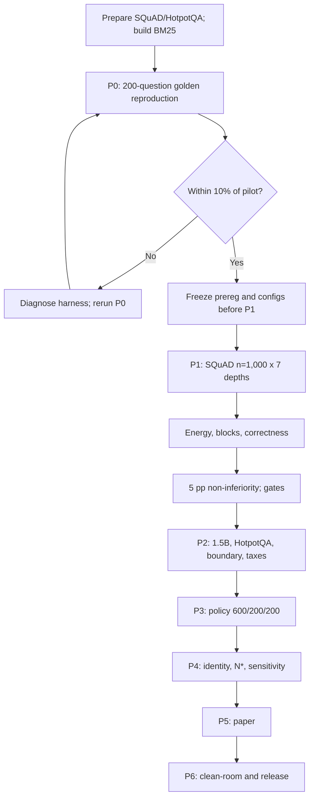

# Energy-Optimal Retrieval Depth in Retrieval-Augmented Generation

**Subtitle:** Joules per correct answer, a certified depth, and the cost of finding it

**Prepared for:** Project supervisor
**Prepared by:** Project team (PI and three collaborators)
**Date:** 2026-11-09
**Version:** 0.1 — supervisor review draft
**Repository:** https://github.com/Atik203/energy-optimal-rag
**Package / environment:** `rag_energy` / `energy-optimal-rag`
**Status:** Post-pilot, pre-confirmatory. This document requests approval to start P0 and P1. No confirmatory results exist.

---

## 1. Executive summary

RAG answers a question by fetching passages and placing them before a language model. The number fetched is the **retrieval depth**, `k`. Depth is usually tuned for accuracy or latency, rarely for **energy per correct answer** — joules per answer actually right. That is what an operator pays, and it can move opposite to accuracy.

This project asks which depth minimizes joules per correct answer subject to an accuracy floor, whether the best depth depends on the query, and whether calibration is worth its energy. The contribution is a decision theory: a gated estimand `E(k)=J(k)/A(k)`, an optimal-depth identity, a price-of-static-depth bound, a certification threshold `N*`, a causal energy-tax test, and a learned policy.

A 200-question pilot on a local RTX 3060 6 GB (1,400 generations, `qwen3.5:4b` Q4, BM25 top-32 over 45,651 passages) found `E(32)=157.1` vs `E(1)=45.5` J/correct (3.45×), affine energy (`R²=.9990`), accuracy flat at .520–.535 for `k=4–16`, and an identity that holds at `k=2` but fails at `k=32`. Repeat CV is 3.80% median.

The pre-registered static 2 pp claim is dead: `k*=32` at the boundary, `P=.61`. At 5 pp the pilot picked `k=4` with 69.3% savings, `N*=876`, `P=.537` — a signal, not certified. The 78.8% oracle gain is a hindsight upper bound.

The rerun is SQuAD `n=1,000` × 7 depths. Primary: 5 pp EM non-inferiority at `k=4` vs `k=32` with ≥20% savings; 2 pp is estimation-only. A 1.5B replication (`n=500`), HotpotQA (`n=500`, `k≤10`), and boundary probe (`n=200`, `k=32/48/64`) test validity; energy taxes test causal signs; a 600/200/200 policy tests adaptivity.

Cost: 15–20 GPU-hours, ≤$47, no rental or paid API; 20 weeks for three to four people. Deliverables: open harness, frozen prereg, energy ledger, analysis code, paper, reproducibility package.

**Decision requested:** approve P0 and P1 now; release P2–P6 after the P1 gate review. Resources: the GPU hours, the $47 cap, and sign-off on the frozen prereg.

---

## 2. The problem in plain language

A RAG system has a **retriever**, which returns `k` **passages** (short chunks; 70 words here), and a **reader**, a language model that answers from the question plus those passages.

More passages can help: the evidence may be in the fifth or twentieth chunk. They can also hurt: irrelevant text distracts the reader, and every passage must be processed. On this laptop, the fixed part of a query costs about 15.7 J and each passage about 2.28 J. At `k=32`, about 73 J of the 89.6 J query is passage processing.

Accuracy-only tuning picks the highest-accuracy depth and stops, even when the last points are extremely expensive. Energy-only tuning picks `k=0`, gets nothing right, and hides its errors in the denominator. The ratio must be paired with an **accuracy gate** `A_min`.

A pilot comparison: 1,000 queries at `k=1` cost 17.98 kJ and yield about 395 correct answers (45.5 J/correct); at `k=32`, 1,000 queries cost 89.55 kJ and yield 570 correct answers (157.1 J/correct). Delivering 570 correct answers at `k=4` costs about 27.5 kJ, 69.3% less than `k=32`, for 5 pp less accuracy. Whether 5 pp is acceptable is a deployment decision, not a property of the model. The best depth is therefore not universal; the useful object is a decision rule.

---

## 3. Why this matters

A 69% saving per correct answer at 5 pp is deployment-relevant: production RAG inference runs millions of times. Operators have an accuracy tolerance, so the green question is margin-indexed; accuracy and latency tuning do not report joules per correct answer.

---

## 4. Research question and hypotheses

**Question.** For a fixed reader, retriever, corpus, and hardware, which depth minimizes joules per correct answer subject to a pre-registered accuracy floor, and does a query-conditional policy beat the best static depth at matched accuracy? Second: is the energy cost of finding the depth smaller than what it saves?

Symbols: `J(k)` mean joules per query; `A(k)` accuracy; `E(k)=J(k)/A(k)`; `A_min` the floor; `k*` the feasible minimizer.

| ID | Hypothesis in words | In symbols |
|---|---|---|
| **H1** | Energy is affine in depth with positive slope and good fit. | `J=a+bk`, `b>0`, `R²≥.95`; lack-of-fit n.s. at 5%. |
| **H2** | At 5 pp EM non-inferiority, `k=4` is non-inferior to `k=32` and saves ≥20%. | `A(4)-A(32)>-.05` one-sided 5%; `1-E(4)/E(32)≥.20`. |
| **H3** | At the interior depth, energy and accuracy elasticities are equal within noise. | `k*J'/J=k*A'/A`; 95% bootstrap interval includes 0. |
| **H4** | Context share is substantial and grows with depth. | `S(k)∈[.10,.70]` at `k*`; `S(k)` increases with `k`. |
| **H5** | Adaptive depth has a real ceiling and a learned policy captures half. | Oracle gain ≥20%; capture ≥50% on 200 held-out questions. |
| **H6** | Changing the energy split moves `k*` in the predicted direction. | Fixed tax raises `k*`; per-passage tax lowers it. |
| **H7** | H2's direction replicates on a second reader or dataset. | 1.5B (`n=500`) or HotpotQA (`n=500`). |

The 2 pp margin is **not** a hypothesis; it is an estimation target with a CI, never a certification claim.

---

## 5. What is new

The metric is not new (Token Arena) and adaptive depth is not new (Hwang; Hashemi et al.; Tail-Aware Adaptive-k; Taguchi et al.). The new object is the decision theory around depth, tested causally.

1. **Gated estimand.** `E(k)=E[J_k]/E[C_k]`, total joules over total correct answers, with a pre-registered floor; the gate stops the ratio from rewarding cheap failure.
2. **Optimal-depth identity.** At an interior optimum, `kJ'/J=kA'/A`; for affine energy the left side is the variable energy share. A scale-free, falsifiable local diagnostic: a context share much larger than the accuracy elasticity means over-retrieval.
3. **Price-of-static-depth bound.** For any static depth there is a query mixture on which it is arbitrarily worse than a query-conditional policy at equal accuracy. An impossibility result, not a claim that a learned policy attains it.
4. **Certification-cost threshold.** Calibration beats a default only when `N>N*=C_cert/[A(k*)(E(k0)-E(k*))]`; finding the depth is itself an energy purchase.
5. **Causal energy-tax test.** A fixed dummy computation raises `a`, a per-passage one raises `b`, with reader, prompt, passages, and answers unchanged. Fixed tax should raise `k*`; per-passage should lower it; a wrong sign falsifies the model.
6. **Learned adaptive policy.** A small cost-sensitive model uses cheap pre-generation features and is tested once on held-out questions at matched accuracy.

**Closest prior work** (search to 8 November 2026; re-run before submission):

- **Pan et al. (NeurIPS 2025 MLForSys):** accuracy–energy landscape; ≤3% accuracy differences span up to 20.2× energy. No `E(k)=J/correct`, gated `k*`, policy, or calibration decision; workshop, cloud models.
- **Lewis et al. (NeurIPS 2020)** introduced retrieval-augmented generation by combining a parametric language model with retrieved documents. It establishes the RAG setting, not an energy-aware retrieval-depth rule.
- **Jeong et al. (NAACL 2024, Adaptive-RAG)** choose among no retrieval, single-step retrieval, and iterative retrieval based on query complexity. This is adaptive retrieval, but it does not optimize measured GPU joules per correct answer.
- **Hwang (2026, OpenReview upload)** adapts depth/context from query difficulty for lower token cost; **Hashemi et al. (arXiv:2510.15719)** use cost-aware RL for ~16–20% lower latency. Both optimize tokens or latency, not joules; neither has `k*` or a guarantee; Hwang is unrefereed.
- **Feric et al., RAGMark (arXiv:2609.05760)** benchmarks per-stage power and reports up to 66% lower energy from context reduction; **Song et al., Tail-Aware Adaptive-k (ECML PKDD 2026)** and **Taguchi et al. (EMNLP 2025)** adapt `k` for retrieval quality or tokens. None measures joules per correct answer or certifies a depth.
- **Gao et al., Token Arena (arXiv:2605.00300)** reports joules per correct answer at endpoint granularity but does not optimize retrieval depth.

We do not claim the metric, adaptive depth, or bandit machinery is new. The combination — gated `E(k)`, identity, static-depth bound, `N*`, causal split test — is absent from the papers found.

---

## 6. How the study works, step by step



| Step | What happens | Output |
|---:|---|---|
| 1 | **Freeze** margins, gates, grids, reader, prompt, scoring, code; tag `prereg-freeze-v1`. | Frozen prereg |
| 2 | **Data/index**: official SQuAD/HotpotQA, SHA-256, seed `20261115`; SQuAD 256-word contexts → 70-word chunks; no HotpotQA pooling; BM25 over 45,651 passages. | Manifest, index |
| 3 | **Sweep**: 7 depths, randomized within question, fresh nonce, fixed prompt, greedy, 24 tokens. | `raw.csv` |
| 4 | **Energy**: NVML 100 ms, idle, trapezoid, 20-query blocks, thermal log. | Calibrated joules |
| 5 | **Score**: EM primary; lenient span and F1≥0.5 secondary; empty/failed = wrong. | Correctness |
| 6 | **Primary/identity**: `A,J,E` as ratio of sums; 5 pp test; savings; bootstrap; affine fit and elasticity gap. | Estimates, interval |
| 7 | **Power/stress**: `n=1,000` primary; 1.5B `n=500`; HotpotQA `n=500`; boundary `n=200`. | Registered runs |
| 8 | **Taxes**: 150 questions/condition; fixed 20% of `a`, per-passage 20% of `b`. | Sign test |
| 9 | **Policy/N***: 600/200/200; `N*` per dataset and reader. | Policy, certification |

**Worked example of `E(k)`.** Pilot values illustrate the arithmetic only.

| Depth | `J(k)` | `A(k)` | `E(k)=J/A` |
|---:|---:|---:|---:|
| 1 | 17.98 J | 0.395 | 45.5 J/correct |
| 4 | 25.10 J | 0.520 | 48.3 J/correct |
| 32 | 89.55 J | 0.570 | 157.1 J/correct |

Savings at `k=4` vs `k=32`: `1-48.27/157.11=69.3%`. For 570 correct answers, `k=32` needs 1,000 queries and 89.6 kJ; `k=4` needs about 1,096 queries and 27.5 kJ. The `E` ratio, 3.25, equals the total-energy ratio; this is why a ratio of sums, not a mean of per-query ratios, is the estimand.

---

## 7. Dataset

| Item | SQuAD v1.1 dev (primary) | HotpotQA distractor (stress) |
|---|---|---|
| Role | Closed-corpus extractive QA | Multi-hop/distractor stress |
| Upstream | 10,570 questions; 20,958 dev contexts | 7,405 questions; 10 paragraphs each |
| Used | 1,000 primary; 500 (1.5B); 500 (Llama 3B, same IDs); 200 boundary/context | 500 |
| Corpus | 20,958 contexts → 45,651 70-word passages | 2 gold + 8 distractors per question; no pooling |
| Retriever / depths | BM25 top-32; `0,1,2,4,8,16,32` | BM25 top-10; `0,1,2,4,8,10` |
| License | CC BY-SA 4.0 | CC BY-SA 4.0 |

SQuAD's closed corpus isolates depth: changing `k` changes how much evidence reaches the reader, not which corpus is searched. That is a strength for mechanism and a weakness for external validity. About 12% of questions have gold evidence outside the top-32 cap, which caps accuracy and adds a final jump at `k=32`; recall@k is reported with every curve.

HotpotQA supplies multi-hop evidence and distractor-induced non-monotonicity; its grid stops at 10 because the setting supplies 10 paragraphs, and pooling across questions would change the task.

**Inclusion/exclusion.** The unit is a question. A **valid row** requires a non-empty nonce, a completed request, and a power window with no sampler error. A failed or empty generation after a completed request is a **wrong answer** (`correct=0`) and is retained, not invalidated; a row is **invalid** only for a protocol violation: missing nonce, request/backend failure, or sampler error. Descriptive `A(k)`, `J(k)`, and `E(k)` use every sampled question with a valid row at depth `k`, and `n_valid(k)` and `n_invalid(k)` are reported at each depth. A question is not dropped from depth `k` because it has no row at another depth. The primary paired test uses questions with valid rows at both `k=4` and `k=32`; the paired `n`, the discordant counts, and the invalid counts are reported. There are no outcome-based exclusions: no winsorizing, trimming, or imputation, and wrong, slow, and throttled answers stay in.

**Licensing/storage.** Both datasets are CC BY-SA 4.0. The repo releases IDs, versions, checksums, seeds, configs, prompts, predictions, and aggregates, never raw text. `data/manifest.json` records source URL, version, split, license, counts, SHA-256, seed, status. Raw text and run CSVs are git-ignored; footprint is under 2 GB plus weights in the Ollama store.

---

## 8. Readers and hardware

Primary reader: Ollama `qwen3.5:4b`, Q4, 3.3 GB, 4096 context, greedy decoding, 24 new tokens. It fits entirely on the 6 GB RTX 3060 Laptop, runs fully on the GPU, and needs no paid API. Confirmatory replication reader: `Qwen/Qwen2.5-1.5B-Instruct` in fp16, a different family and size, already cached; if the direction survives both, it is less likely to be a one-model artifact. Exploratory third reader: Ollama `llama3.2:3b`, Q4_K_M, 4096 context, same 500 SQuAD IDs as the 1.5B arm; it is direction-only and does not change H7 or G5. Host: Ryzen 7 5800H, 32 GB RAM, Windows; one GPU, batch 1, no concurrent jobs. Retriever: BM25 Okapi, deterministic and CPU-only.

**Boundary and context caveat.** The pilot's `k*=32` was the grid boundary. One explanation is 4096-token truncation; another is that 32 passages genuinely help. The boundary probe adds `k∈{32,48,64}` with an 8k context budget, because 70-word passages at `k=64` can exceed 4096 tokens. A separate 16k context-budget probe on Qwen3.5-4B (`n=200`, `k=32/48/64`, plus a `k=32 @ 4096` control) tests truncation and recall. It is not a 16k-token prompt at `k≤64` and is not a new `k*`. The probe requires 100% GPU residency; if the 6 GB card offloads, the hardware limit is reported. The optional H200 64k check is accuracy-only and makes no energy claim.

---

## 9. Measurement protocol

Primary sensor: NVML `power.draw` via `pynvml` every 100 ms, with utilization, memory, temperature, SM clock. The 100 ms label is a cadence, not precision: the laptop driver updates power about once per second. Absolute joules depend on block calibration and repeat CV; per-query values are for pairing and bootstrap.

| Control | What we do | Why it exists |
|---|---|---|
| Idle | 60 s pre-run (15.56 W, CV 10.4%); post-run check | Removes background; post-run lowers energy ~4% uniformly, `E` ratios <1% |
| Blocks | 20 back-to-back queries per depth | Per-query windows miss the ~100 ms ramp; pilot factors 1.041–1.188 |
| Nonce | Fresh 10-hex per request | Prefix cache cut prefill 710→247 ms after a shorter prefix |
| Thermal | Log temp, clock, throttle; cool between halves | Pilot clock fell 39%, temp rose 16 °C |
| Repeats | 3×20 at `k=8` | Noise floor; MDE≈2×CV; pilot 3.80% median, 9.24% max |
| Wall meter | 30-query subset | Whole-system cross-check |
| CPU proxy | BM25 time ×20 W; sensitivity 10/15/25 W | No `pyRAPL`; upper bound; pilot 3.11 J/query |

Depth order is shuffled within each question, so thermal drift is a within-question nuisance. The Ember carbon factor is recorded as a constant conversion, not a new optimization. The BM25 proxy is the only non-measured term: 3.5% of total at `k=32`, 17.3% at `k=1`. Context share uses the 2.283 J/passage slope; retrieval share uses the CPU proxy; they are never conflated. For a query, `J_k=J_ret+J_pre+J_dec+J_fix`.

The 16k probe records `prompt_tokens` and invalidates any row with `prompt_tokens + num_predict > num_ctx`; it requires `ollama ps` to report 100% GPU and >300 MB headroom. The H200 MIG slice exposes no per-instance power reading, so H200 rows are accuracy-only and never enter the energy ledger.

---

## 10. Outcomes and analysis

Primary estimand: `E(k)=ΣJ_k(q_i)/ΣC_k(q_i)`, total joules over total correct answers, not the mean of per-query ratios.

| Quantity | Definition | Role |
|---|---|---|
| `A(k)`, `J(k)` | Mean correctness; mean joules/query | Curves |
| `E(k)` | `J/A` as ratio of sums | Primary |
| `A_min`, savings | `A(32)-0.05`; `1-E(k)/E(32)` | Gate; ≥20% |
| `S`, `S_r` | `(J_ret+J_pre)/J`; `J_ret/J` | Shares |
| `ε_J`, `ε_A` | `kJ'/J`; `kA'/A` | Identity |
| `k*`, `P(k*)`, `N*` | Feasible argmin; bootstrap probability; break-even | Selection |
| Capture | `(E_static-E_policy)/(E_static-E_oracle)` | Adaptive |

**Primary test.** One-sided paired non-inferiority at α=.05, margin 5 pp, `k=4` vs `k=32`: null `A(4)-A(32)≤-0.05`; the 95% lower bound must exceed −5 pp, and savings must be ≥20%. If the test rejects but savings are below 20%, the result is “non-inferior but not materially greener” and the policy claim fails.

**Secondary and uncertainty.** 2 pp uses the same procedure but is estimation-only; margin sensitivity runs at 2, 3, 4, 5, 6, 8, 10 pp, and scoring sensitivity at strict EM, lenient span, and F1≥0.5. The conclusion must survive all three or the dependence is reported. Uncertainty uses 10,000 paired bootstrap resamples over questions, with percentile intervals for `E`, `A`, `S`, the identity gap, and `k*`; the non-inferiority test is paired on correctness, and the bootstrap is the uncertainty layer, not a substitute.

**Identity/coverage.** The identity is tested at the selected depth with fitted affine `J` and finite-difference `A'`. The coverage model `A(k)=1-(1-A0)(1-p)^k` is fitted with `R²` and lack-of-fit; the pilot fit was poor (`A0=.324`, `p=.0218`, `R²=.332`), so global unimodality is rejected and the identity remains local. The rerun tests it on SQuAD, 1.5B, and HotpotQA; Llama 3B is an exploratory extension.

**Exploratory reader and context arms.** The Llama 3.2 3B reader is reported direction-only (sign of `A(4)-A(32)` and affine slope), with a CI, no gate, and no promotion. The context-budget probe reports `k=32` at 4096 versus 16384, plus `k=48/64` at 16384, with truncation and `recall@k`. Neither arm changes H7/G5 or supports a universal `k*`.

**No survival analysis.** There is no survival, time-to-event, or censoring analysis. Every question contributes binary correctness and measured energy at each depth; pairing is handled by the bootstrap. One primary test; everything else is secondary or exploratory, with Holm as the default if a secondary family is promoted. No gate is re-thresholded after the primary outcome.

---

## 11. Power and sample size

The pilot's accuracy side was underpowered: at `n=200` the MDE was about 4–5 pp, so 2 pp could not be certified. Planning assumes a paired-difference SD of 0.283 (discordant rate .08); SE=`0.283/√n`. “True loss” is candidate minus reference; negative is worse. A planning table, not a result.

| `n` | SE | 5 pp NI power at 0/1/2/3 pp loss | 2 pp NI power at 0/1 pp loss | 95% CI half-width |
|---:|---:|---|---|---:|
| 500 | 1.27 pp | .99/.94/.77/.47 | .47/.20 | 2.5 pp |
| 1,000 | 0.89 pp | >.99/.998/.96/.72 | .72/.30 | 1.8 pp |
| 2,500 | 0.57 pp | >.99/>.99/>.99/.97 | .97/.55 | 1.1 pp |

**Why `n=1,000`.** Comfortably powered for 5 pp at 0–2 pp loss, reasonable at 3 pp, and fits the budget. The 95% half-width is about 1.8 pp: enough to estimate a 2 pp difference, not to certify one. That is the preregistered distinction.

**Underpowered/exploratory.** 2 pp certification is underpowered at every size here and is not attempted. The boundary probe (`n=200`) is diagnostic; HotpotQA subgroups are exploratory; the policy test set is 200, so a capture near 50% will have a wide interval; the 1.5B run (`n=500`) is powered for H2's direction, not 2 pp. The Llama 3B panel and context probe are exploratory/diagnostic and are not powered for 5 pp per arm.

---

## 12. Theory

The theory is small and falsifiable: three results and one counterexample; proofs go in the appendix.

**Assumptions.** (A1) `A(k)=1-(1-A0)(1-p)^k`, with `A0∈[0,1)`, `p∈(0,1]`: each passage independently supplies the needed evidence with probability `p`. Stylized, not universal. (A2) `J(k)=a+bk`, `a,b>0`; the pilot supports this (`R²=.9990`) but rejects A1's global fit.

**Theorem 1.** `E=J/A` decreases then increases, with a unique minimizer possibly at a boundary. At an interior optimum, `bA(k*)=(a+bk*)A'(k*)`, or `k*J'/J=k*A'/A`; `k*` is nondecreasing in `a` and nonincreasing in `b`; if `A0>0`, `k*=0` when `b/a≥(1-A0)(-ln(1-p))/A0`. In words: marginal energy per passage equals marginal accuracy value in elasticity units. The identity is scale-free and diagnostic, not a global proof. The pilot fits: gap +0.044 at `k=2` (CI includes zero), +0.700 at `k=32`.

**Theorem 2.** For any `K≥1`, a query mixture exists where the best static depth meeting accuracy 1 is `K`, the oracle also meets accuracy 1, and `E(static)/E(oracle)=(a+bK)/(a+εbK)→1+bK/a` as `ε→0`: a fraction `1-ε` is easy (correct at 0 and `K`), a fraction `ε` is hard (correct only at `K`). For any `M>1`, `a<bK/(M-1)` makes the ratio exceed `M`; no static depth is minimax-optimal over heterogeneous queries.

**Theorem 3.** With `Δ_k=E(k)-E(k*)>0` and delta-method variance `σ_k²`, identifying `k*` with probability ≥`1-δ` needs at least `max_k 2σ_k²/Δ_k²·log(1/(2δ))` queries; successive elimination uses `O(Σ_k σ_k²/Δ_k²·log(K/δ))`. The bandit machinery is standard; the ratio variance and gated feasible set are the new parts.

The calibration corollary is the decision-changing result: `E_cal(N)=E(k*)+C_cert/(NA(k*))`, so calibration beats default `k0` exactly when `N>N*=C_cert/[A(k*)(E(k0)-E(k*))]`. A small deployment should **not calibrate**. The pilot sweep cost 49.6 kJ and gave `N*=876` for `k=4`; at 10,000 queries the saving is 566 kJ vs 49.6 kJ (8.8%), at 100,000 it is 0.9%.

**Distractor counterexample.** With `a=1`, `b=.02`, `K={0,1,2,4}`, `A=(.6,.9,.7,1.0)`, `E=(1.667,1.133,1.486,1.080)`: a local minimum at `k=1`, a lower global minimum at `k=4`. A greedy policy stops at 1 and misses 4; certification must search globally, or test monotonicity and rerank/compress first. HotpotQA is where this is most likely.

**Falsification.** A wrong tax sign falsifies the affine/split model; an identity gap excluding zero at every interior depth falsifies the diagnostic; a non-monotone SQuAD curve falsifies global unimodality, though not the local identity; a policy capturing no material oracle fraction falsifies the practical value of adaptivity.

---

## 13. Expected results and contributions

If G1/G2 pass, the paper reports a 5 pp static policy at `k=4` with ≥20% savings; if G4 passes, the learned-policy fraction of a ≥20% oracle gap; if the theory holds, the identity and comparative statics; if gates fire, a measurement/negative paper. Artifacts are an MIT harness, ledger, frozen prereg, data card, protocol, and Zenodo package.

---

## 14. Feasibility

**Roles.** Three to four people, with overlap: PI/theory (claim boundary, prereg, theory, gates, paper); measurement/harness (NVML, blocks, nonce, thermal, wall meter, CI, registry); data/analysis (prep, BM25, scoring, bootstrap, power, identity, certification); policy/paper (features, policy, held-out evaluation, figures, reproducibility).

**Timeline.** Twenty weeks; human time is binding.

| Phase | Weeks | Goal | Exit gate |
|---|---|---|---|
| **P0** | 1 | Scaffold, CI, environment, manifest, golden reproduction | `E(k)` within 10%; K7; `validate` clean |
| **P1** | 2–3 | Powered SQuAD `n=1,000` × 7 | G1 or documented failure |
| **P2** | 4–6 | 1.5B, Llama 3B exploratory, HotpotQA, boundary, 16k probe, taxes | G5; tax signs; exploratory arms reported |
| **P3** | 7–10 | Policy 600/200/200 | G4 or negative |
| **P4** | 11–14 | Identity, `N*`, sensitivity | Theory report |
| **P5** | 15–18 | Paper and figures | Numbers trace to a run |
| **P6** | 19–20 | Clean-room, release | Reproduction matches |

**Compute/cash.** Local 3060 only for energy; no rental or paid API. The optional H200 64k
accuracy-only check uses existing university access and no paid API; it is not part of the
local GPU-hour or cash budget.

| Item | Cost |
|---|---:|
| GPU | $0 |
| Electricity | ~$2 |
| Wall meter | $25 |
| USB backup | $10 |
| Contingency | $10 |
| **Total** | **≤$47** |

**Storage.** `E:\PROJECT\energy-optimal-rag`; raw text and run CSVs git-ignored; under 2 GB plus model weights in the Ollama store; USB holds the second copy. The local additions are estimated at 1.2–1.7 GPU-hours, within 15–20 total. If schedule tightens, drop the optional H200 check first, then the 16k probe or Llama 3B panel, before dropping the boundary probe or 1.5B replication; never drop the primary.

---

## 15. Risks and mitigations

| ID | Risk | Why it matters | Mitigation |
|---|---|---|---|
| R1 | Strict EM vs lenient | A string match could decide the green verdict | Pre-register EM; report lenient and F1; require survival across all three |
| R2 | Reader strength/saturation | A stronger reader could flatten accuracy and move `k*` | 1.5B, exploratory Llama 3B, 16k probe, and HotpotQA; reader-conditional results; no universal claim |
| R3 | Single corpus/retriever | Closed SQuAD and BM25 limit validity | HotpotQA; recall@k; boundary in every claim |
| R4 | Thermal throttling | Pilot clock fell 39%, temp rose 16 °C | Randomize `k`; log clocks/temp; steady-state blocks; first-50 sensitivity |
| R5 | Coarse NVML | Per-query joules can look too precise | Blocks; repeat CV; wall meter; sensor caveat in every table |
| R6 | Prefix cache | Reused KV confounds depth with order | Unique nonce; verify prefill; invalidate rows without one |
| R7 | Energy noise | Small effects can be swamped | Idle, blocks, repeats, bootstrap, pre-registered MDE; K7 |
| R8 | Policy overfitting | 600 training questions is small | Strict split; simple model; no test tuning; feature-free baseline |
| R9 | Binding gate defeats tax test | At ceiling, `k*` may not move | Mid-accuracy tax condition; report gated and unconstrained |
| R10 | Data licensing | CC BY-SA 4.0 forbids unlicensed redistribution | No raw text; IDs, checksums, prompts, predictions, aggregates |
| R11 | Schedule/scope slip | 20 weeks, small team; universal or carbon claims overreach | P6 buffer; drop H200, then 16k/Llama, before boundary/1.5B; never drop primary; claim boundary and amendment required |
| R12 | Model shopping | A third reader can invite winner-selection | Pre-specify the Llama panel; report all readers; H7/G5 unchanged; no post-outcome promotion |
| R13 | 16k OOM/offload | A CPU-offloaded row is not a valid local measurement | Require 100% GPU; record prompt tokens; report hardware limit |
| R14 | H200 energy confusion | MIG power telemetry is unavailable | Accuracy-only; no H200 joules; never pool with RTX 3060 |

The two thesis-changing risks are scoring dependence (R1) and a binding gate (R9); both are pre-registered.

---

## 16. Ethics, privacy, licensing, and open science

Both datasets are public Wikipedia-derived corpora; they are not PII-audited, and no private queries, logs, or personal data will be added. Code is MIT; docs and derived artifacts are CC BY 4.0; SQuAD and HotpotQA remain CC BY-SA 4.0. Model weights are not redistributed: Qwen3.5-4B and Qwen2.5-1.5B-Instruct are Apache 2.0, while Llama 3.2 3B Instruct uses the gated Llama 3.2 Community License (not OSI open source). The repo releases IDs, checksums, prompts, predictions, aggregates, never raw text; weights, credentials, and secrets are not committed.

The preregistration is frozen before P1 and tagged `prereg-freeze-v1`. Deviations go into `prereg/amendments.md` and `docs/DECISIONS.md` with date, original text, reason, and whether outcomes were seen; analysis records hashes and refuses on mismatch. The energy ledger and claims-evidence map are tracked and checksummed. A fired gate is reported, not tuned away; the dead 2 pp claim is reported; the 78.8% oracle is an upper bound; no carbon-optimal claim is made from a constant factor.

---

## 17. Deliverables and decision requested

**Approval scope.** P0/P1 means: build the scaffold, prove the harness on a 200-question golden reproduction, freeze the preregistration, and run the powered SQuAD experiment (`n=1,000`, seven depths). P2–P6 are released after the P1 gate review.

**Success/failure.** P1 success is G1: 5 pp non-inferiority at an interior `k` with ≥20% savings, plus G2 support. P3 success is G4: ≥20% oracle gap and ≥50% capture at matched accuracy. P2 success is G5: replication on 1.5B or HotpotQA. The Llama 3B panel and context probe are exploratory and do not change G5 or H7. Failure is a fired gate, reported and reframed. A null adaptive result does not invalidate the static measurement; a null static result does not invalidate the theory or harness.

**Gate actions.** K1 stops the depth story; K2 extends the grid once, then reframes; K3 raises power once, then drops static certification; K4 reframes to generation; K5 pivots to policy; K6 kills adaptivity; K7 fixes measurement. G1–G2 are static gates, G3 the split, G4 adaptive, G5 external validity; definitions in Appendix B.

**Resources.** Three to four people for 20 weeks; 15–20 GPU-hours on the local 3060; a $47 local cap ($2 electricity, $25 wall meter, $10 USB backup, $10 contingency); supervisor sign-off on the frozen prereg; access to the Ollama store, the cached 1.5B reader, and the optional university H200 accuracy-only check.

**Decision.** Approve P0/P1 now. The first 10 days produce a working harness, reproducible pilot curve, frozen prereg, power memo, and the first half of the powered run. If the golden reproduction differs by more than 10% at any depth, P1 stops until the harness is fixed.

---

## 18. Glossary

| Term | Definition |
|---|---|
| **RAG** | Retrieval-augmented generation: fetch passages, then answer from them. |
| **Retrieval depth (`k`)** | Number of passages placed in the prompt. |
| **Passage** | A short text chunk; 70 words here. |
| **Prefill / decode** | Processing the prompt / generating answer tokens. |
| **`E(k)`** | Joules per correct answer. |
| **Correctness gate (`A_min`)** | Minimum accuracy before a depth competes on energy. |
| **Static / adaptive** | One depth for all queries / a per-query depth. |
| **Oracle** | Hindsight cheapest-correct-depth policy; an upper bound, not learned. |
| **`N*`** | Queries at which calibration energy equals the energy it saves. |
| **Non-inferiority** | Not worse than reference by more than a pre-set margin. |
| **Bootstrap** | Resampling questions to estimate uncertainty. |
| **Elasticity** | Percent change in one quantity per 1% change in another. |
| **Context budget** | The `num_ctx` allocation, not the number of tokens actually filled. |
| **Exploratory arm** | A reported analysis with no gate and no certification claim. |
| **MDE** | Smallest effect distinguishable from noise. |
| **NVML** | NVIDIA Management Library; GPU power, temperature, clocks. |
| **BM25** | Classical keyword-ranking retriever. |
| **Preregistration** | Frozen hypotheses, margins, gates, analyses before confirmatory data. |

---

## 19. References

Only works and resources named in the project's source documents. Details are reproduced as recorded there; some full texts were unavailable during the source audit.

1. Lewis, P., et al. *Retrieval-Augmented Generation for Knowledge-Intensive NLP Tasks.* NeurIPS 2020.
2. Jeong, S., et al. *Adaptive-RAG: Learning to Adapt Retrieval-Augmented Large Language Models through Question Complexity.* NAACL 2024, pp. 7036–7050. DOI 10.18653/v1/2024.naacl-long.389.
3. Pan, M., et al. *Towards Automatically Optimizing Retrieval Augmented AI Systems.* NeurIPS 2025 MLForSys Workshop. OpenReview `an17DUVvuS`.
4. Hwang, M. *Query Complexity–Aware Adaptive Retrieval for Cost-Efficient Retrieval-Augmented Generation.* OpenReview direct upload, 2026. `ObkC4BCAFt`.
5. Hashemi, H., Rühle, V., Rajmohan, S. *Cost-Aware Retrieval-Augmentation Reasoning Models with Adaptive Retrieval Depth.* arXiv:2510.15719, 2025.
6. Feric, Z., et al. *RAGMark: A Comprehensive Framework for Benchmarking Retrieval-Augmented Generation Systems.* arXiv:2609.05760, 2026.
7. Song, Z., et al. *Tail-Aware Adaptive-k: Query-Adaptive Context Selection for Retrieval-Augmented Generation.* ECML PKDD 2026, LNCS 16944, pp. 193–209. DOI 10.1007/978-3-032-37667-1_12.
8. Taguchi, C., Maekawa, S., Bhutani, N. *Efficient Context Selection for Long-Context QA: No Tuning, No Iteration, Just Adaptive-k.* EMNLP 2025, pp. 20105–20130. DOI 10.18653/v1/2025.emnlp-main.1017.
9. Gao, Y., Wang, M., Yu, Y. L. *Token Arena: A Continuous Benchmark Unifying Energy and Cognition in AI Inference.* arXiv:2605.00300, 2026.
**Data and tools.** SQuAD v1.1 dev (CC BY-SA 4.0); HotpotQA distractor dev (CC BY-SA 4.0); BM25 Okapi via `rank_bm25`; NVML via `pynvml`; Ollama `qwen3.5:4b`; Qwen2.5-1.5B-Instruct (Apache 2.0); Llama 3.2 3B Instruct (Llama 3.2 Community License); Ember *Yearly Electricity Data*. URLs, versions, and SHA-256 are in `data/manifest.json`.

---

## Appendix A. Pilot evidence: what it established and what it did not

Pilot: 200 SQuAD v1.1 dev questions, `k∈{0,1,2,4,8,16,32}`, 1,400 generations, RTX 3060 6 GB, `qwen3.5:4b` Q4, BM25 top-32 over 45,651 passages.

| Quantity | Pilot value | Status | Interpretation |
|---|---|---|---|
| `E(32)` vs `E(1)` | 157.1 vs 45.5, 3.45× | Supported | Steep tradeoff, not universal |
| Energy fit | `J=15.74+2.283k`, `R²=.9990` | Supported | Affine on this grid, not a law |
| Accuracy | `.395→.570`; flat `.520–.535` at `k=4–16` | Supported | Gains early; strict EM; reader-limited |
| Context share | 36.3%→85.1%; retrieval 3.5–17.3% | Supported | Lever is prefill; CPU proxy upper bound |
| Identity `k=2` | +0.044, CI [−.050,+.128] | Supported | Local diagnostic |
| Identity `k=32` | +0.700 | Rejected | Flags over-retrieval |
| Repeat CV | 3.80% median, 9.24% max | Supported | Usable noise floor |
| Static 2 pp | `k*=32` boundary; `P=.61<.8` | **DEAD** | Power/margin failure; do not resurrect |
| 5 pp | `k=4`, 69.3%, `N*=876`; `P=.537` | Pilot signal, not certified | Needs `n=1,000`; NI test and selection probability reported separately |
| Adaptive oracle | 78.8% matched-accuracy gain | Upper bound only | No learned policy |

**Established.** The tradeoff is real and steep here; the affine model and context share are stable; the identity is a useful local diagnostic and flags over-retrieval; `k=4` is a promising 5 pp candidate; the harness is repeatable enough for a powered run.

**Not established.** No universal or 2 pp-optimal depth; no powered 5 pp non-inferiority; no learned policy; no completed Llama 3B or 16k context run; no causal split test; no global coverage model. The paper must say all of this.

---

## Appendix B. First 10-day sprint and gates

| Day | Task and acceptance |
|---:|---|
| 1 | Scaffold, CI, governance; `pytest -q` passes locally and in CI |
| 2 | Environment, CLI, config schema; all configs parse, `validate` exits 0 |
| 3 | SQuAD prep, 70-word chunks, BM25; 1,000 questions, ≥45k passages, recall@32 reproducible |
| 4 | Energy harness: NVML, idle, blocks, nonce; idle CV <20%, factors recorded, nonce forces prefill |
| 5 | Golden reproduction 200×7; `E(k)` within 10%, repeat CV <20% |
| 6 | Freeze prereg/configs; hash recorded, no outcome peeking |
| 7 | Power/sample lock; `n=1,000` justified, 2 pp estimation-only |
| 8 | P1 sweep, first half; no sampler errors, thermal log complete |
| 9 | P1 sweep, second half, QA; all depths, exclusions documented |
| 10 | Gate review K1–K7 / G1–G5; decision in `docs/DECISIONS.md` |

**Kill/reframe gates.**

| Gate | Criterion | Pilot | Action if fired |
|---|---|---|---|
| **K1** | Relative energy effect <10% | PASS (245%) | Stop depth story; report null |
| **K2** | `k*` at boundary `{0,K_max}` | FAIL (`k*=32`) | Extend grid once; else reframe |
| **K3** | `P(k*)<0.8` | FAIL (.61) | Raise power once; else drop static certification |
| **K4** | Context share <5% and flat | PASS (36–85%) | Lever is generation; reframe |
| **K5** | `k*` spans >1 depth | FAIL (span 3) | Pivot to policy; no population `k*` |
| **K6** | Oracle gain <15% | PASS (78.8%) | Kill adaptivity if held-out test fires |
| **K7** | CV >20% or MDE > effect | PASS (3.80%) | Fix measurement; do not interpret |

**Go gates.**

| Gate | Criterion |
|---|---|
| **G1** | 5 pp non-inferiority at interior `k`, ≥20% savings vs `k=32` |
| **G2** | Upper confidence bound on accuracy loss ≤5 pp, `P(k*)≥0.8` for 5 pp selection |
| **G3** | Context share at selected `k` in [0.10,0.70], varying with `k` |
| **G4** | Oracle gain ≥20%, learned policy captures ≥50% at matched accuracy |
| **G5** | Replication on 1.5B reader or HotpotQA |

---

## Appendix C. Repository map and scaffold checks

The repository layout is `configs/` (base, runs, grids, taxes, analysis/prereg), `data/` (manifest; raw text git-ignored), `src/rag_energy/` (data, retrieval, readers, energy, stats), `scripts/` (00_prepare_data … 09_make_figures), `tests/` (smoke tests without numpy/pandas), `prereg/` (frozen intent and amendments), `runs/` (registry tracked; per-run outputs ignored), `artifacts/` (ledger, claims-evidence map), and `docs/` (this proposal, plan, protocol, measurement, data card, risks).

From the repo root, in `energy-optimal-rag`:

```powershell
conda env create -f environment.yml
conda activate energy-optimal-rag
python -m pip install -e ".[dev]"
python -m pytest -q
python -m rag_energy.cli validate
python scripts\01_smoke_test.py
```

Expected: smoke tests pass without numpy, pandas, torch, or GPU; `validate` prints `OK` for all ten configs and `All configs valid.`; the smoke script prints `smoke test: PASS`. In v0.1.0, `00_prepare_data.py` and the sweep scripts are stubs that exit non-zero by design; P0 fills them. The two `tests/test_smoke.py` tests pass locally and in CI. If a command downloads data, uses a paid API, or writes outside `E:\PROJECT\energy-optimal-rag`, stop and ask.
